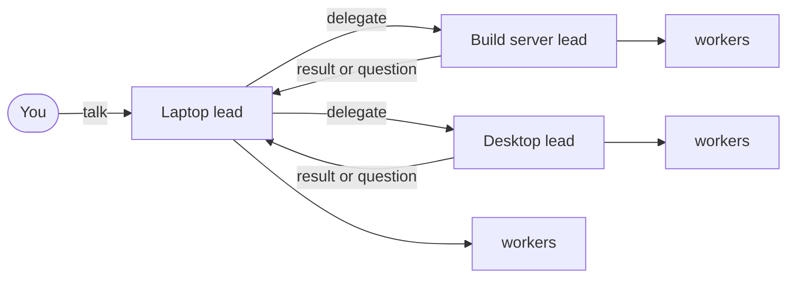

# toli

**Turn the coding agent you already use into a small team: one lead you talk to on each computer, worker agents
that do the work in the background, and proof before anything is called done.**

    curl -fsSL https://yuyudhan.github.io/toli/install | sh

Clones the latest toli release into a folder you choose (it asks) and checks it; needs `git` and `bun`.
[Other ways to install](docs/install.md).

## What toli is

You open your agent in the toli folder and talk to it. That session is the **lead**. The lead never does the work
itself, so it is always free to listen: it writes each request down as a task and sends **worker agents** (background
subagents) to do it, several at once, while you keep talking. Results come back to the lead by themselves, with
evidence.

- **A task queue.** Every request becomes a task with an id, a status, and a report. Nothing is lost between
  sessions, and you can always ask what is in flight.
- **A Needs-you queue.** When a decision only you can make comes up (push, merge, release, anything destructive), the
  task is held with one clear question, its options, and a recommendation. All of them wait in one place
  (`bin/toli needs`, or `/ahoy` in chat), and the rest of the work carries on.
- **Scheduled jobs.** "Every weekday at 9 am, summarise yesterday's commits" becomes a job that runs in the
  background on its own schedule, never in your chat ([jobs](docs/jobs.md)).
- **Safe delivery.** Work is committed on the project's branch, and that is where it stops: no push, pull request,
  merge, or release without your word for that change. Your uncommitted work is never thrown away
  ([how work lands](docs/delivery.md)).
- **Proof before done.** Every task ends with real test output, logs, or screenshots, and for code a second,
  independent worker checks that proof before it is committed.
- **Works with your agent.** omp, Claude Code, Codex, Cursor, Grok CLI, and pi share one contract and one set of
  skills; workers can run on any of them ([harnesses](docs/harnesses.md)).

## Who it is for

Developers who already work with a coding agent in the terminal and want more than one thing done at a time: several
fixes, investigations, and test runs in parallel, across several projects, on one computer or on every computer they
own, without babysitting each one.

## Quickstart

    curl -fsSL https://yuyudhan.github.io/toli/install | sh

The installer asks where to put toli, clones the latest release, and checks it. Then open your agent in the toli
folder (`omp`, `claude`, `codex`, `cursor-agent`, `grok`, or `pi`) and say:

> set up toli

It asks a few questions in one go (this computer's name, your first project, how work should land) and a worker does
the rest ([first-run setup](docs/setup.md)).

Runs on macOS, Linux (Debian/Ubuntu and Fedora), and Windows through WSL2; native Windows (PowerShell) is not
supported ([supported platforms](docs/install.md#supported-platforms)).

## Several computers, one team

toli is built to run on every computer you work with: a laptop, a desktop, a build server. Each computer has its own
clone of toli, its own private records, and its own lead. You talk to whichever lead is in front of you, and the
leads pass work, messages, and learnings between each other over plain `ssh`.

- **One lead per computer.** Each lead starts and watches only its own computer's workers, and every worker reports
  only to its own lead. No computer starts a worker on another one; work for another computer goes to that
  computer's lead ([one lead per machine](docs/sardars.md)).
- **A lead service.** `bin/toli lead install` keeps each computer's lead conversation running in the background
  (launchd on macOS, a systemd user service on Linux), so a computer with no terminal open still takes delegated work,
  answers messages, and starts workers. `bin/toli lead attach` opens that conversation in your terminal.
- **Delegate work between computers.** `bin/toli delegate <machine> "<title>" --brief <file>` puts a task in another
  computer's queue. Its result, or its question, comes back to your lead by itself; your lead answers what it can and
  brings the rest to your Needs-you queue. `bin/toli task list --fleet` shows every computer's tasks in one list, as
  `<machine>/T<n>`.
- **Talk to another lead.** `bin/toli talk <machine> "<words>"` sends a message that wakes that lead;
  `bin/toli talk <machine>` opens its conversation in your terminal.
- **Share learnings.** `bin/toli share "<learning>"` sends a lesson or a working rule to the other leads. Each one
  adopts it, adapts it, or declines it with a reason, and the answer comes back to you.
- **Work goes where the queue is shortest.** Each computer publishes its queue: tasks waiting for a worker plus
  running workers. `bin/toli fleet queues` ranks the computers by queue length per worker slot, and `bin/toli pick`
  names the best one for a unit of work. Leads balance on their own: a long queue offers work to a short one, and an
  empty queue asks for work. A computer that cannot take more says so with `bin/toli lead full` and is passed over
  until it clears ([queues decide where work goes](docs/sardars.md#queues-decide-where-work-goes)).
- **A disk keeper on every computer.** When free disk falls under a floor, toli deletes rebuildable build output
  (build targets, `node_modules`, idle Docker build volumes) until there is room again. Low disk never stops work
  ([the disk keeper](docs/disk.md)).
- **Build slots.** Heavy builds share a fixed number of slots per computer (`bin/toli build-slot -- <command>`), with
  compile jobs split between them, so parallel workers never overload one machine
  ([heavy-build slots](docs/fleet.md#heavy-build-slots)).
- **Messages survive a sleeping laptop.** Anything meant for a computer that is offline waits in an outbox and is
  delivered when it is reachable again. A computer that must not accept incoming `ssh` pulls its messages instead.
- **Upgrades that never cut work short.** toli checks for a new release every 3 days and tells you once; nothing
  changes until you say so. `bin/toli sync --all` on the coordinator (the computer that keeps the fleet list) then
  moves every computer to it. Running workers finish on the code they started with, and each lead service switches
  to the new code between turns
  ([keeping machines in sync](docs/fleet.md#keeping-machines-in-sync), [update check](docs/install.md#update-check)).

To add a computer, install toli on it and say "set up toli"; it asks for the computer's role (`bin/toli init`) and
how to reach the others ([machines: the fleet](docs/fleet.md)).

## Things you can say

- "Add billing-api from git@github.com:acme/billing-api.git, as pull requests."
- "Fix the login redirect bug in billing-api."
- "Find out why the web-app build got slow. Don't change anything yet."
- "Run the full test suite on whichever machine has the shortest queue."
- "Every weekday at 9 am, summarise yesterday's commits in billing-api."
- "Push T12 and open the PR."
- "Clean old build folders every hour on this machine."
- "What's waiting on me?" (or `/ahoy`; `/bearings` for the full picture)

## The names

toli uses a few names of its own. By default the lead is called **Sardar** and each worker a **jawan**; a group of
workers sent out together for one request is a **toli**. You can choose the names for yourself, the lead, and the
workers in `config/persona.json`, and the lead uses them everywhere ([persona names](docs/setup.md#persona-names)).

## Learn more

- [How it works](docs/how-it-works.md): the lead, workers, proof, safety rules, and where everything is kept
- [Install and upgrade](docs/install.md) and [first-run setup](docs/setup.md)
- [Projects](docs/projects.md) and [how work lands](docs/delivery.md): pull requests, fixed branches, worktrees
- [Several computers](docs/fleet.md) and [one lead per machine](docs/sardars.md)
- [Scheduled jobs](docs/jobs.md), [memory](docs/memory.md), [machine helpers](docs/helpers.md),
  [the disk keeper](docs/disk.md)
- [Harnesses](docs/harnesses.md) and the [command reference](docs/cli.md)
- [All docs](docs/README.md), including [working on toli itself](docs/development.md)

## License and credits

MIT, see [LICENSE](LICENSE). toli is inspired by [firstmate](https://github.com/kunchenguid/firstmate) (MIT): the
idea of one lead agent that never does the work itself and stays available while worker agents do it, and the names
of several workflow skills (afk, ahoy, bearings, quiet, stow). toli is a separate implementation; no firstmate code is
included.
