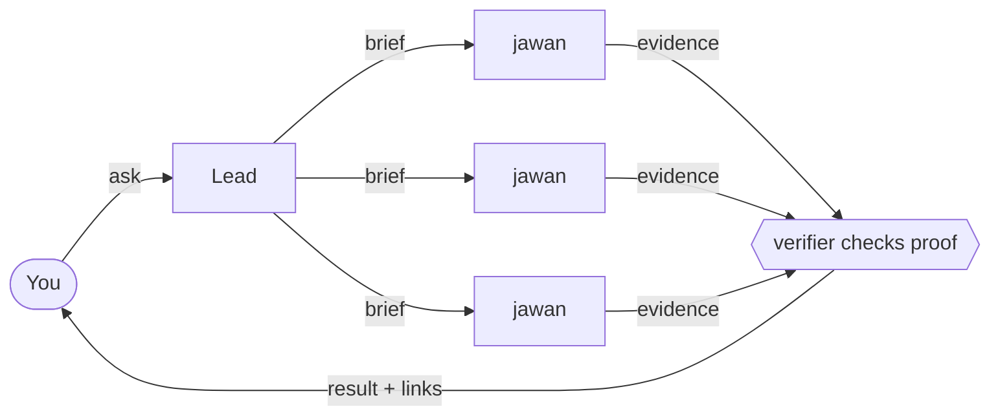

# toli

**One lead you talk to, a crew of agents that do the work, and proof before anything is called done.**

toli turns the coding agent you already use into a small team. You talk to one session, the lead (Sardar). It never
does the work itself, so it is always free to listen; it writes each request down and sends jawans (background
subagents) to do it, in parallel, while you keep talking.

## Why toli

- **Always available.** The lead only listens, plans, and dispatches. Ask for five things in a row; none of them
  blocks the chat, and results arrive by themselves when they are ready.
- **Jawans do all the work, in parallel.** Code, investigations, tests, commits, and reports, several at once, even
  on the same project, across all your projects and machines.
- **Works with your agent.** omp, Claude Code, Codex, Cursor, Grok CLI, and pi share one contract and one set of
  skills; jawans can run on any of them.
- **Nothing is "done" without proof.** Every task ends with real test output, logs, or screenshots, and for code a
  second, independent jawan checks that proof before it is committed.
- **Safe by default.** Work is committed, and that is where it stops: no push, PR, merge, or release without your
  word, and your uncommitted work is never thrown away.
- **Nothing gets lost.** Every request becomes a task, every decision waits for you in one place, and memory stays
  small and current.

## Quickstart (60 seconds)

    curl -fsSL <toli-raw-url>/install.sh | sh

The installer asks where to put toli, clones the latest release, and checks it. To install a specific release:

    curl -fsSL <toli-raw-url>/install.sh | sh -s -- --version v0.1.0

Then open your agent in the toli folder (`omp`, `claude`, `codex`, `cursor-agent`, `grok`, or `pi`) and say:

> set up toli

It asks you a few questions in one go (this machine's name, your first project, how work should land) and a jawan
does the rest.

## Things you can say

- "Add billing-api from git@github.com:acme/billing-api.git, as pull requests."
- "Fix the login redirect bug in billing-api."
- "Find out why the web-app build got slow. Don't change anything yet."
- "Every weekday at 9 am, summarise yesterday's commits in billing-api."
- "Run the full test suite on whichever machine is free."
- "Push T12 and open the PR."
- "Clean old build folders every hour on this machine."
- "What's waiting on me?" (or `/bearings`)

## The names

| Name   | Plural   | Who                                                 |
| ------ | -------- | --------------------------------------------------- |
| Malik  |          | you                                                 |
| Sardar | Saradars | the lead: the agent session you talk to             |
| jawan  | jawans   | one helper (a background subagent) doing one task   |
| toli   |          | a group of jawans sent out together for one request |
| paltan |          | all jawans working across all your machines         |

Not your style? Pick your own names for you, the lead, and the jawans in `config/persona.json`
([docs/setup.md](docs/setup.md#persona-names)).

## Learn more

- [How it works](docs/how-it-works.md): the lead, jawans, proof, safety rules, and where everything is kept
- [Install](docs/install.md) and [first-run setup](docs/setup.md)
- [Projects](docs/projects.md) and [how work lands](docs/delivery.md): PRs, fixed branches, worktrees, no-mistakes
- [Scheduled jobs](docs/jobs.md), [several machines](docs/fleet.md), [memory](docs/memory.md),
  [machine helpers](docs/helpers.md)
- [Harnesses](docs/harnesses.md) and the [command reference](docs/cli.md)
- [All docs](docs/README.md), including [working on toli itself](docs/development.md)

## License and credits

MIT, see [LICENSE](LICENSE). toli is inspired by [firstmate](https://github.com/kunchenguid/firstmate) (MIT): the
idea of one lead agent that never does the work itself and stays available while worker agents do it, and the names
of several workflow skills (afk, ahoy, bearings, quiet, stow). toli is a separate implementation; no firstmate code is
included.
