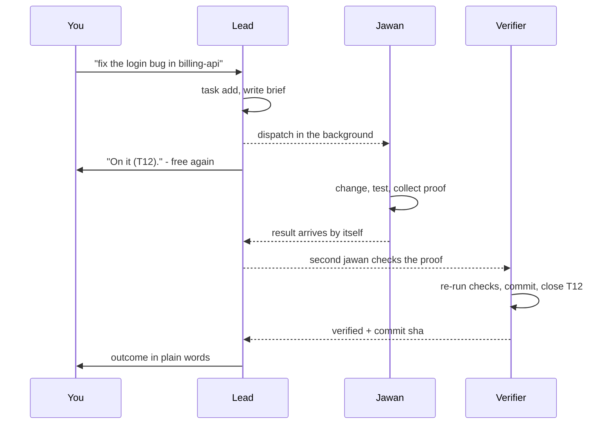

# How toli works

toli is a folder you open your coding agent in. The agent session started there is the **lead** (Sardar by
default). You talk only to the lead; the lead turns every request into a written task and hands it to **jawans**,
background subagents that do all of the work: reading code, investigating, testing, committing, writing reports.
A group of jawans sent out for one request is a toli; all jawans across your machines are the paltan (all names:
[README](../README.md#the-names)).

## The one principle

**The lead never works; jawans do everything; the lead stays available.** The lead does not read code, check proof,
commit, write reports, build pages, or run releases, not even "quick" ones. Its own job is only:

- listening to you, picking the project, and asking at most one clarifying question;
- writing the brief for a jawan ([brief-template.md](brief-template.md),
  [verify-brief-template.md](verify-brief-template.md));
- fast bookkeeping with `bin/toli` (tasks, digest, project settings);
- asking you before anything that pushes, merges, releases, or destroys.

On omp and Claude Code a guard enforces this: the lead may write only toli's own records (`data/`, `state/`,
`config/`) and may not read project code. Jawans are never guarded. Details: [harnesses.md](harnesses.md#lead-guard-and-guidance).

## A request, start to finish

1. **Record.** Every request that implies work becomes a task in the same turn (`bin/toli task add`), so nothing
   is lost even if it is only an aside. Each task has a shape: **ship** (changes code) or **scout** (investigates
   and writes a report to `data/projects/<project>/reports/`, never touches code).
2. **Dispatch.** The lead fills in the brief (your words verbatim, spec, acceptance lines, the project's notes) and
   starts a jawan in the background: the harness's own async subagents, or `bin/toli spawn` on any installed
   harness. It replies in a line or two and ends its turn; you can keep talking or ask for more work.
3. **Work in parallel.** Several jawans (a toli) can run at once, even on the same project and the same files.
   Nothing is locked or queued; each jawan commits only the paths it changed. Where they work depends on the
   project's [workspace strategy](projects.md#workspace-strategy).
4. **Result.** When a jawan finishes, its result arrives in the chat on its own (see [Results find you](#results-find-you)).
5. **Verify.** For ship work a second, independent jawan checks the first one's evidence against the acceptance
   lines, re-runs the checks, then commits with `bin/toli commit` and closes the task, or reports what is missing
   and the lead sends a fix.
6. **Report.** The lead tells you the outcome in plain words, with full links to any commit, PR, or report.

Questions a jawan cannot answer put the task on hold (`bin/toli task hold`); `/ahoy` walks you through them and
`bin/toli task answer` records your reply in the project's `decisions.md`.

## Proof before done

Work is done only when jawans pasted real output for every acceptance line, and for ship work a second jawan has
checked it. The brief always asks for the project's tests or smoke check. When the project's notes say so:

- UI and API work: the logs are checked and the local URL is opened in a headless browser or requested over HTTP;
- UI changes: before/after screenshots at the widths in the notes' `## Proof` section;
- bug fixes: the test failing before the fix and passing after.

Staging is only read, never changed, and jawans stop at any OTP or captcha.

## Safe by default

- Work lands as a commit on the project's branch, as its [delivery mode](delivery.md) says. Nothing is pushed,
  merged, released, or opened as a PR without your word for that specific change, unless you gave the project an
  explicit standing grant.
- Uncommitted work is never discarded: no `git reset --hard`, `git checkout -- <path>`, `git stash`, `git clean`,
  branch deletion, or force push over changes the jawan did not make.
- Destructive, irreversible, or security-sensitive actions always go to you first.
- No git worktrees or terminal multiplexer windows, except the per-task worktrees toli itself creates for a
  project whose strategy is `worktree-per-task`.
- No AI co-author trailers (`bin/toli commit` strips them); your name appears in chat only, never in commits,
  PRs, or code.
- Scheduled and headless runs never push, merge, open PRs, or ask questions; they write results to files.
- A finding or recommendation is evidence, not permission to change code.

## Results find you

Jawan outcomes, scheduled job results, and messages from other machines land in toli's records (`data/inbox/`,
`data/jobs/`). `bin/toli wake` takes everything new since the last call, once, and the harness brings it into the
chat:

- **omp**: the extension (`.omp/extensions/toli.ts`) runs `wake` every minute and pushes a `[toli wake]` message
  into the session, so the lead relays it without being asked.
- **Claude Code**: the prompt hook runs `wake` and adds new results to your next message.
- **Codex, Cursor, Grok, pi**: the lead sees them in `bin/toli digest`.

Delivered items keep showing in `bin/toli digest` and `/bearings` until acknowledged (`bin/toli job ack`,
`bin/toli inbox ack`). Long-running things (work on other machines, fleet probes, lavish pages) also run in the
background and arrive the same way.

## Talking to the lead

Say what you want in plain words. A few modes and pages help:

- **Coming back**: after 30 minutes or more without a message from you, the lead's next reply starts with what needs
  you, what finished (with links), and what is still running. `/bearings` gives the full picture any time.
- **`/quiet`**: you are here but want only outcomes, failures, and decisions.
- **`/afk`**: you are away; the lead keeps working the queue and gives one summary when you are back.
- **Decision pages**: when there are several options, a batch of questions, or a large report, a jawan builds a
  lavish page (`npx -y lavish-axi`) so you can tick choices in the
  browser instead of typing. Pages live in `.lavish/` and are never shared. Yes/no questions stay in chat.
- **Local stacks**: if a project's notes have a `## Local stack` section, the lead starts and stops the stack in the
  background with exactly those commands. Migrations, logs, and health checks go to a jawan.

Every slash command is listed in [cli.md](cli.md#slash-commands).

## Records

Everything toli knows lives in plain files inside the toli folder. Tracked files (the contract `AGENTS.md`, skills
and commands in `.omp/`, `bin/`, `src/`, `docs/`) are the same on every machine; everything below is gitignored and
private to each machine.

    projects/<name>/             project clones (or symlinks to your own checkouts)
    projects/.worktrees/         per-task worktrees (worktree-per-task projects)
    config/machine.json          this machine: name, role, capacity, harness, defaults, memory budget, retention
    config/fleet.json            every machine (docs/fleet.md)
    config/jobs.json             scheduled jobs (docs/jobs.md)
    config/persona.json          optional names (docs/setup.md)
    local/                       private machine helpers (docs/helpers.md)
    data/projects.json           this machine's projects
    data/backlog.json            tasks: queued, active, held, done, dropped
    data/projects/
/           notes.md, briefs/, reports/, runs/, decisions.md (docs/projects.md)
    data/preferences.md          your preferences (docs/memory.md)
    data/learnings.md            lessons learned across projects
    data/reports/                toli-wide reports
    data/jobs/<name>/<stamp>.md  job results
    data/inbox/, data/remote/    messages from jawans and other machines; remote runs without a project
    data/archive/                archived memory entries and old tasks; never loaded
    state/                       session, job and ack state, outbox/, runs/, jawan run records
    logs/, .env*, .lavish/

`bin/toli digest` reads all of it at the start of every session: this machine's name and role, each project's branch
and uncommitted state, work in flight, decisions waiting on you, unseen job results, and inbox messages.

## Where to go next

- Tasks, projects, and where jawans work: [projects.md](projects.md)
- How work lands: [delivery.md](delivery.md)
- Several machines: [fleet.md](fleet.md)
- Timed jobs: [jobs.md](jobs.md)
- Memory and cleanup: [memory.md](memory.md)
- Harness details and `bin/toli spawn`: [harnesses.md](harnesses.md)
